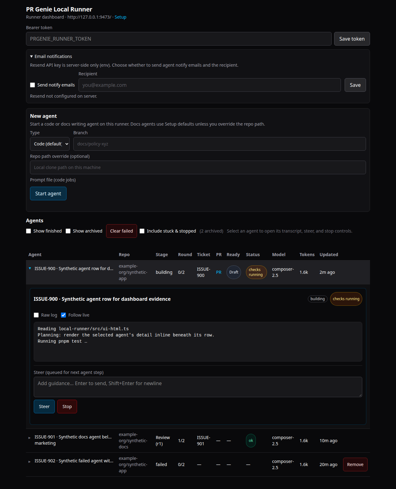

# PR Genie

Local pull requests for agent work. GitHub when you say so.

PR Genie gives you a **git-native review lane** before anything hits GitHub: branch, diff, comments, and status live in your repo until you export. Two install paths share the name `prgenie` but solve different problems — read [Which PR Genie do I need?](#which-pr-genie-do-i-need) first.

## Which PR Genie do I need?

| You want…                                                                                         | Install                                                                                        | MCP server id      | `prgenie` means…                                                    |
| ------------------------------------------------------------------------------------------------- | ---------------------------------------------------------------------------------------------- | ------------------ | ------------------------------------------------------------------- |
| **Automated implement → PR → review loop** on a workstation (MCP `start_job`, optional dashboard) | [npm `prgenie`](packages/npm-prgenie/README.md) (`npx -y prgenie` or `npm install -g prgenie`) | `prgenie-runner`   | Runner: `init`, `doctor`, `mcp`, `serve`, `config`                  |
| **Cursor steward + local PR sidebar** (human review, export gate, no push until you say so)       | Monorepo [plugin + extension](#install-from-source-monorepo-cursor-plugin-extension)           | `prgenie` (plugin) | Monorepo CLI: `create`, `list`, `steward`, `export`, … (`pnpm cli`) |

- The **Local PRs** sidebar (extension) lists **git-native local PRs** from the plugin/monorepo CLI. It does **not** show npm runner jobs started via `prgenie mcp` or the HTTP dashboard — use the [runner dashboard](packages/npm-prgenie/README.md#optional-http-dashboard) for those.
- `prgenie doctor` and `prgenie mcp` behave differently per binary (runner vs plugin CLI). Run doctor from the install you care about.
- Keep **both** MCP ids distinct (`prgenie` + `prgenie-runner`) if you use plugin and runner together.

## Happy path (Cursor plugin — local review lane)

Requires **Node.js 22+**, **git**, **GitHub CLI (`gh`)**, and **Cursor** with the plugin and extension built from this repo ([contributing setup](docs/contributing.md)).

1. **Link plugin + extension** — `pnpm build && pnpm link-plugin && pnpm link-extension`, then Customize → Plugins → PR Genie off/on, and fully quit/reopen Cursor for the Local PRs sidebar.
2. **`/steward`** with a ticket URL or brief — steward Tasks an implementor, then a reviewer; do not implement in the steward chat.
3. **Switch** into the loop worktree (Local PRs sidebar or MCP) and let the implementor land commits on the feature branch.
4. **Review** — reviewer uses `/review`, files findings, then `complete_review` (MCP or CLI).
5. **Export** — when the steward reports `handoff_human` (export gate green), run `/export` or **Open on GitHub** in Local PRs.

Subagent auto-capture is **off by default** (`PRGENIE_CAPTURE_SUBAGENT=1` to draft a loop when a coding subagent commits). There is **no** inbox/queue listen flywheel — use `/steward` only.

**UI cues:** Local PRs sidebar (extension) is your watch list. Loop **STATUS** goes `draft` → `ready` → `changes_requested` or `reviewed` → `approved`. The loop stays `ready` while the reviewer files findings; `complete_review` then sets `changes_requested` (open findings) or `reviewed` (review cleared), and addressing the last finding returns it to `ready` for another pass. After a clear review the steward runs the export gate, and `/export` sets `approved`. Full lifecycle, including `review_interrupted` and head drift: [Local PR lifecycle](docs/architecture.md#local-pr-lifecycle). Runner jobs use the web dashboard instead:



_Screenshot: the **npm runner** HTTP dashboard (`npx -y prgenie serve`), not the Local PRs sidebar._

**Control plane:** to adopt an existing CloudAgent or GitHub PR instead of starting from `/steward`, bind `gh`, then `prgenie attach` and `prgenie shepherd` — see [Control plane (attach and shepherd)](docs/contributing.md#control-plane-attach-and-shepherd).

## Quick start (npm runner)

For the **published runner** (npm **0.1.3** on `main`): MCP stdio job loop without cloning this repo.

Requires **Node.js 22+**, **git**, **`gh`**, and **`cursor-agent`** for real (non–dry-run) jobs. Full walkthrough: [packages/npm-prgenie/README.md](packages/npm-prgenie/README.md).

```bash
npx -y prgenie init
npx -y prgenie doctor
# Wire MCP client (Cursor, Claude Code, Claude Desktop, VS Code):
npx -y prgenie config --client cursor
```

Use server id **`prgenie-runner`**. Prefer `npm install -g prgenie` when the network is slow or MCP hosts time out starting `npx` (see npm README).

## Supported repositories

Today PR Genie targets **JavaScript/TypeScript** repos with **pnpm or npm** workspaces (package scripts for lint/test/build). CI selection and export gates assume that layout.

Unsupported or exotic layouts (no package manager, non-JS stacks, custom CI without `pnpm`/`npm` scripts) may fail export gates or `run_ci` with environment errors — fix tooling in the primary checkout first, or scope work to supported paths. Docs-only jobs on the **npm runner** can use `jobType: "docs"` with bundled markdown lint defaults.

## What it is

| Piece                                    | Role                                                                                    |
| ---------------------------------------- | --------------------------------------------------------------------------------------- |
| `@prgenie/core` + monorepo `prgenie` CLI | Create/list/approve **local PRs** from any worktree (`pnpm cli`)                        |
| Cursor plugin                            | No-push rule, `/steward`, `/review`, steward MCP (`prgenie`), optional subagent capture |
| VS Code / Cursor extension               | **Local PRs** sidebar for plugin loops — Switch, review, export (not runner jobs)       |
| npm `prgenie` package                    | Runner MCP (`prgenie-runner`), optional HTTP dashboard + `serve`                        |

## What it is not

- Not a subagent orchestrator (Cursor's Task tool owns spawn/stop)
- Not a GitHub PR client (GitLens owns remote PRs after export)
- Not a Conductor replacement

<a id="install-from-source-monorepo-cursor-plugin-extension"></a>

## Install from source (Cursor plugin and extension)

See [docs/contributing.md](docs/contributing.md) for `link-plugin`, `link-extension`, monorepo CLI reference, storage, and maintainer checks. Summarized:

```powershell
pnpm install
pnpm build
pnpm link-plugin
pnpm link-extension
```

Plugin MCP timeout is **4200s** (heavy CI tools); see [MCP timeouts](docs/troubleshooting.md#mcp-timeouts--progress).

## Docs

- [Contributing / maintainer setup](docs/contributing.md)
- [npm package README](packages/npm-prgenie/README.md) — MCP clients (incl. Claude Desktop + Windows), notify/Resend, first job
- [Architecture](docs/architecture.md) — packages, lifecycle, steward flywheel
- [Troubleshooting](docs/troubleshooting.md) — `doctor`, sticky Connecting…, `spawn npx ENOENT`, export/`gh` bind
- [ADR 0001: extension → local runner](docs/decisions/0001-extension-to-local-runner.md)
- [Default review bar](docs/review-bar.md)
- [Local runner source](local-runner/README.md) (development; not the plugin steward)

## Roadmap

[ROADMAP.md](ROADMAP.md)

## License

MIT
